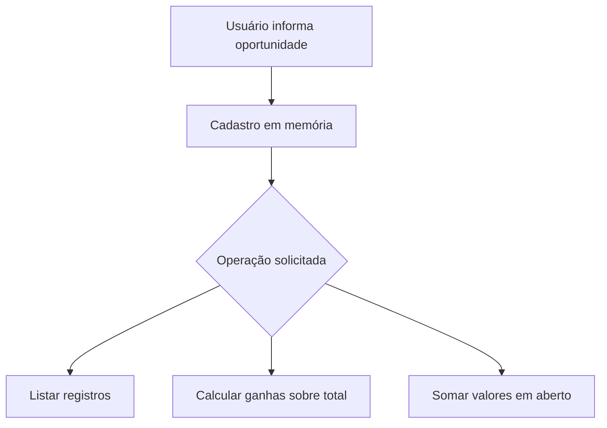
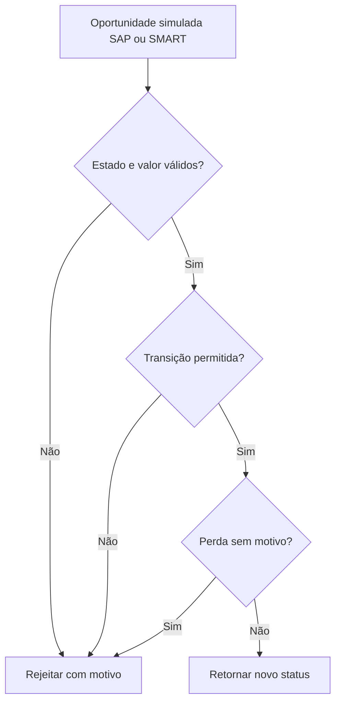

# Processos AS-IS e TO-BE

O AS-IS parte do [projeto de pipeline existente](https://github.com/danielfernandomartins/pipeline-comercial-python): cadastro e indicadores em memória, sem edição de status, validação de valores ou histórico. O TO-BE abaixo é uma proposta didática separada; não altera a aplicação original. SAP e SMART são nomes informados pelo proprietário do portfólio. Neste estudo, identificam apenas a origem simulada de uma oportunidade. Campos, transições e papéis abaixo não são documentação interna do Bradesco, especificação SAP ou integração real.

## AS-IS

## TO-BE proposto

Atores: executivo solicita; motor valida; gestor aprovaria a política. O retorno não persiste a mudança. Transições permitidas: prospeccao → negociacao/perdida; negociacao → ganha/perdida. Ganha e perdida são terminais. Repetir o mesmo estado é rejeitado. A validação ocorre na ordem: dados, transição, motivo de perda.

Os diagramas são fluxogramas Mermaid de escopo didático; não são apresentados como BPMN validado. Integração, persistência e interação com pessoas estão fora do protótipo.
