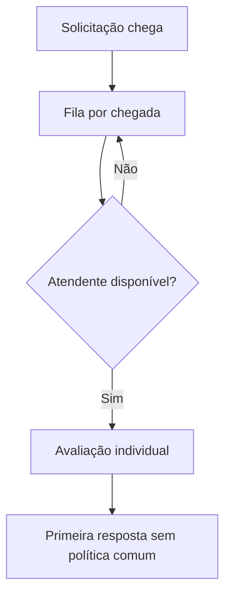
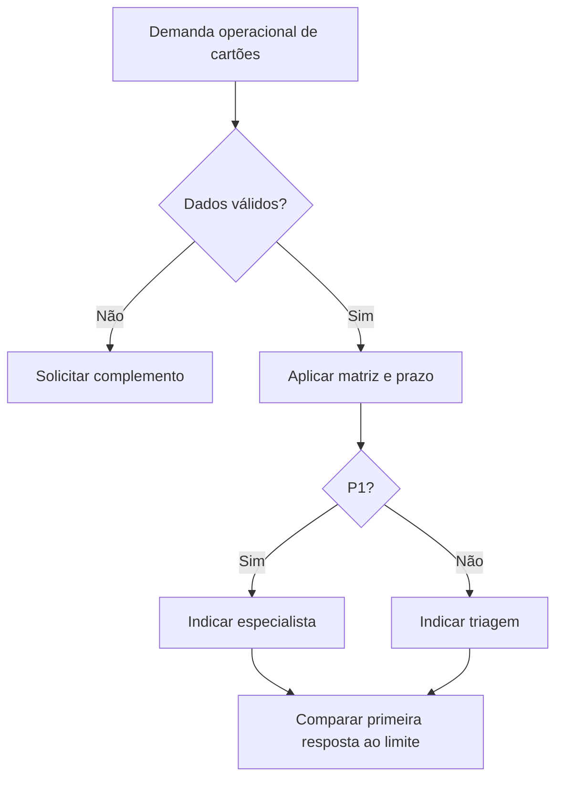

# Processos AS-IS e TO-BE

AS-IS hipotético: uma fila atendida por ordem de chegada, sem matriz documentada. Não foi observado um service desk real. A proposta é independente dos laboratórios de suporte existentes e usa uma política fictícia de operação contínua. O contexto escolhido é uma fila de dúvidas de fatura/acesso de cartões inspirada apenas na existência de canais públicos de atendimento. Prioridades, grupos e prazos são inventados para o exercício e não representam política do Bradesco Cartões.

## AS-IS

## TO-BE proposto

Impacto: 1 = operação inteira do serviço, 2 = uma equipe, 3 = uma pessoa. Urgência: 1 = atividade bloqueada sem alternativa, 2 = alternativa temporária, 3 = pode aguardar. São definições didáticas, não classificação de segurança ou saúde. Abertura inicia o relógio; primeira resposta encerra a aferição. Resposta no futuro, anterior à abertura ou datas sem fuso exigem revisão. A matriz avalia impacto operacional na fila de atendimento, não risco individual do consumidor. A resposta didática não decide mérito de contestação, elegibilidade ou obrigação do banco.

Os diagramas são fluxogramas Mermaid de escopo didático; não são apresentados como BPMN validado. Integração, persistência e interação com pessoas estão fora do protótipo.
