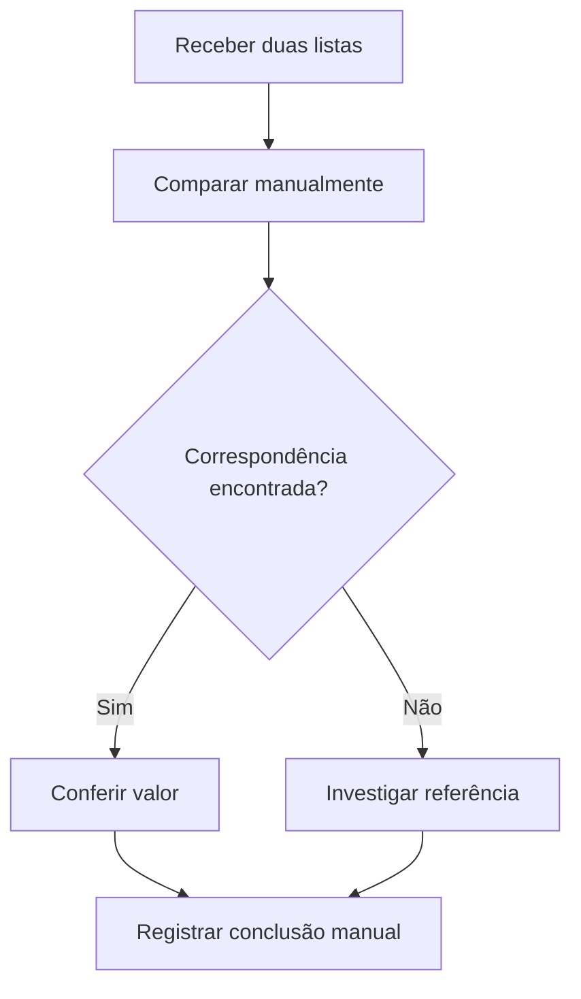
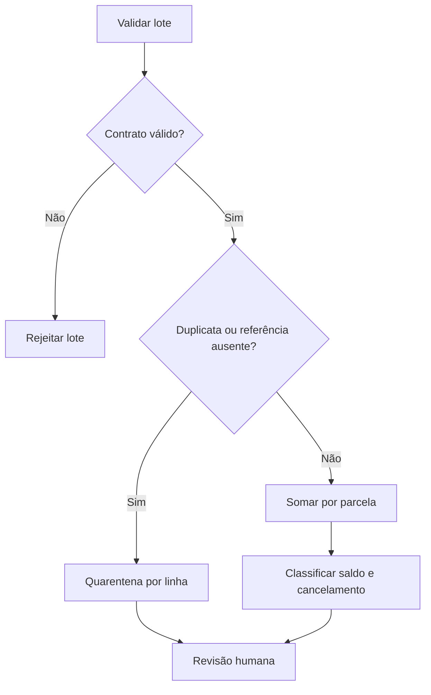

# Processos AS-IS e TO-BE

AS-IS hipotético: comparação manual de parcelas com uma lista de pagamentos. Nenhuma empresa, sistema bancário ou transação real foi utilizada. O protótipo recebe dados sintéticos locais e não executa baixas, cobranças ou transferências. O tema faz referência a Bradesco Consórcios como contexto público, sem reproduzir regras contratuais, procedimentos de baixa ou arquivos internos.

## AS-IS

## TO-BE proposto

Operações fornece as duas listas e recebe resultado por parcela e exceções por linha. O motor não modifica as entradas. A mesma fotografia produz o mesmo resultado; isso não representa prevenção de baixa duplicada em um sistema externo. Parcelas canceladas não possuem diferença calculada (null). O saldo null significa não avaliado; não indica inexistência de obrigação de pagamento.

Os diagramas são fluxogramas Mermaid de escopo didático; não são apresentados como BPMN validado. Integração, persistência e interação com pessoas estão fora do protótipo.
