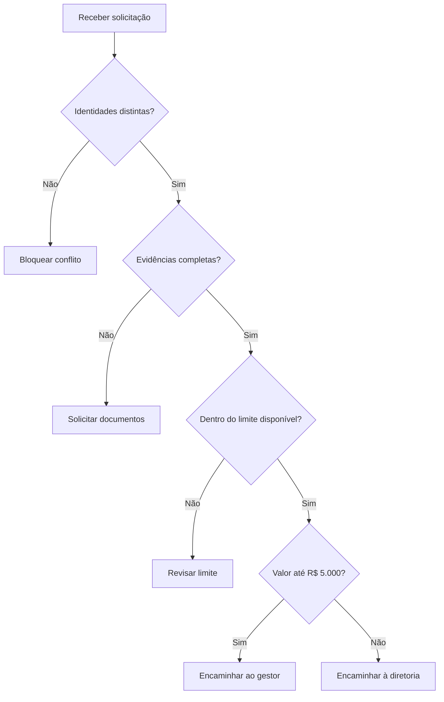

# Encaminhamento de solicitações de estorno — contexto de agência Bradesco

Estudo independente preparado com assistência de IA, ligado ao contexto da experiência profissional no Bradesco informada pelo autor. Dados, atores, políticas, valores e processos são fictícios. Não representa projeto realizado no banco, procedimento interno, aprovação institucional ou resultado empresarial. Não usa dados de clientes. A experiência informada contextualiza a escolha do problema; o estudo demonstra artefatos de análise.

## Problema e objetivo

Como encaminhar uma solicitação com evidências e revisão adequada, sem confundir triagem com autorização financeira?

**Competências:** descoberta, processos, requisitos funcionais, regras, critérios de aceite, riscos e apoio à decisão.

## Processo atual e proposto

AS-IS hipotético: solicitação recebida por mensagem, conferência manual e encaminhamento sem regra explícita. Riscos: documentação incompleta e conflito de papéis.

**TO-BE:** Atendente registra → triagem valida campos → bloqueia conflito de papéis → solicita documentos → verifica limite disponível → encaminha ao gestor ou à diretoria. Nenhum pagamento é realizado.

### Fluxo proposto



O fluxo representa a proposta didática; não é um processo interno confirmado do Bradesco.

## Escopo e responsáveis hipotéticos

Analista de Negócios documenta e mantém rastreabilidade; atendente fornece exemplos; gestor de operação revisa política; tecnologia avalia viabilidade; responsável de negócio decide aceite. Não houve entrevista ou validação com essas pessoas.

MVP: classificar ou calcular uma entrada de cada vez. Fora do escopo: integração bancária, persistência, permissões reais, trilha de auditoria e implantação. A saída é apoio à análise humana.

## Histórias e requisitos

Como responsável pela operação, quero aplicar critérios explícitos para entender o encaminhamento e conferir exceções. Como analista, quero comparar entradas e saídas para discutir regras com negócio e tecnologia.

| ID | Regra Must / critério de aceite | Cenários |
|---|---|---|
| E1 | Encaminhar valores até R$ 5.000 ao gestor e acima disso à diretoria | C01, C02, C03 |
| E2 | Impedir solicitante e aprovador com o mesmo ID após normalização | C04, C11 |
| E3 | Exigir sinalização booleana de evidências completas | C05 |
| E4 | Encaminhar para revisão quando o valor superar o limite disponível | C06, C07 |
| E5 | Validar valores finitos positivos, até duas casas, e IDs não vazios | C08, C09, C10, C12 |

## Contrato de dados

valor: decimal positivo; orcamento: limite disponível simulado, decimal não negativo (nome técnico herdado do protótipo); solicitante/aprovador: IDs fictícios; documentos: bool. Saída: fila recomendada, nunca aprovação.

## Critérios de aceite executáveis

[Cenários e entradas fictícias](cenarios.json) · [Protótipo](prototipo.py) · [Resultado da execução](resultado.md).

Cada cenário explicita Dado (entrada), Quando (avaliar), Então (esperado), com ID e requisito. Os resultados esperados foram definidos como exemplos de negócio, incluindo fronteiras e rejeições.

Na raiz do repositório, execute com Python 3.10+ sem dependências:

```bash
python analise-negocios/novos-casos/validar.py
```

## Indicadores e limites de interpretação

Percentual de pendências = solicitações pendentes / solicitações válidas; revisão de limite = revisões / válidas. Bloqueios e erros devem aparecer separados. Prazo e redução de retrabalho exigem timestamps e baseline ainda não coletados.

## Descoberta, alternativas e decisões

Avaliar se alçada deve considerar valor individual ou acumulado; quem mantém os limites; quem autoriza exceções; quais evidências são suficientes? Limites de R$ 5.000 e orçamento são escolhas didáticas, sem fonte interna.

Alternativas: manter conferência manual com checklist; adotar triagem por regras; integrar ao fluxo operacional. Escolha de estudo: regra local reproduzível, por permitir conferir fronteiras sem depender de sistemas. A escolha não comprova viabilidade de integração.

## Riscos, mudança e homologação

Riscos: hipótese incorreta de processo, regra ambígua, dados incompletos e automação indevida de uma decisão humana. Mitigação proposta: revisão com negócio, exemplos de exceção e piloto autorizado.

Mudança de regra exige atualizar requisito, cenário, protótipo e resultado, e avaliar efeitos em solicitações em andamento. Testes locais não equivalem a homologação empresarial.

Plano de aceite pendente: revisar o fluxo com responsável de negócio; validar os exemplos; registrar divergências; ajustar regras; executar amostra sintética acompanhada; obter decisão explícita do responsável. Não há aceite ou implantação concluídos.

## Como apresentar em entrevista

Explique o problema, uma hipótese ainda não validada, uma regra de fronteira e a diferença entre resultado do protótipo e benefício real. Execute um cenário alterando a entrada e justifique a saída. Apresente este material como estudo de portfólio ligado ao seu repertório bancário.

[Contexto, fontes e roteiro geral](../README.md)
