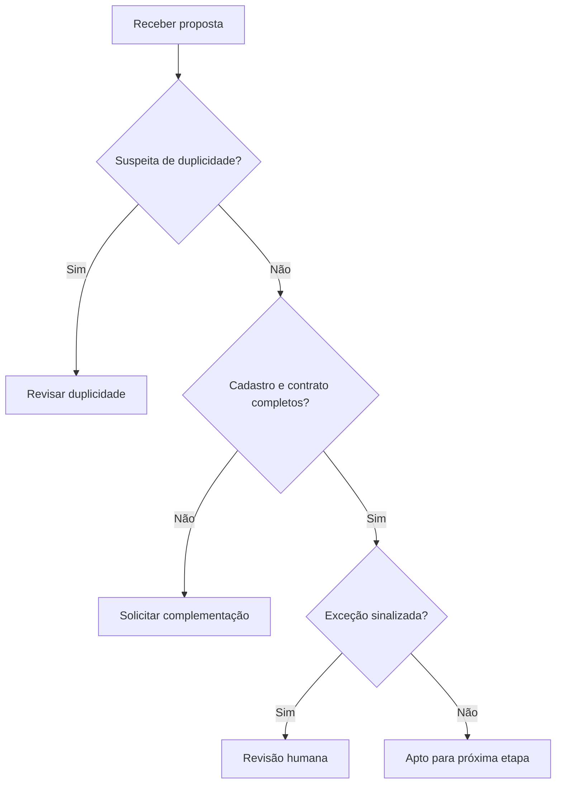

# Pendências de cadastro e ativação — contexto Bradesco

Estudo independente preparado com assistência de IA, ligado ao contexto da experiência profissional no Bradesco informada pelo autor. Dados, atores, políticas, valores e processos são fictícios. Não representa projeto realizado no banco, procedimento interno, aprovação institucional ou resultado empresarial. Não usa dados de clientes. A experiência informada contextualiza a escolha do problema; o estudo demonstra artefatos de análise.

## Problema e objetivo

Como tornar visível o motivo de uma proposta não seguir para ativação e evitar que pendências sejam interpretadas como conclusão?

**Competências:** descoberta, processos, requisitos funcionais, regras, critérios de aceite, riscos e apoio à decisão.

## Processo atual e proposto

AS-IS hipotético: proposta é recebida, documentos conferidos e pendências comunicadas sem classificação uniforme. Não é um diagnóstico da operação real.

**TO-BE:** Atendente recebe ID sintético → verifica suspeita de duplicidade → verifica completude → encaminha exceção à revisão humana → sinaliza aptidão para próxima etapa. Aptidão não abre conta.

### Fluxo proposto



O fluxo representa a proposta didática; não é um processo interno confirmado do Bradesco.

## Escopo e responsáveis hipotéticos

Analista de Negócios documenta e mantém rastreabilidade; atendente fornece exemplos; gestor de operação revisa política; tecnologia avalia viabilidade; responsável de negócio decide aceite. Não houve entrevista ou validação com essas pessoas.

MVP: classificar ou calcular uma entrada de cada vez. Fora do escopo: integração bancária, persistência, permissões reais, trilha de auditoria e implantação. A saída é apoio à análise humana.

## Histórias e requisitos

Como responsável pela operação, quero aplicar critérios explícitos para entender o encaminhamento e conferir exceções. Como analista, quero comparar entradas e saídas para discutir regras com negócio e tecnologia.

| ID | Regra Must / critério de aceite | Cenários |
|---|---|---|
| A1 | Sinalizar aptidão apenas quando completo, sem duplicidade ou revisão | C01, C12 |
| A2 | Exigir marcadores cadastro e contrato antes de encaminhar | C02, C03, C04, C08 |
| A3 | Priorizar revisão de duplicidade sobre outras pendências | C05, C07 |
| A4 | Encaminhar exceções completas à revisão humana | C06 |
| A5 | Rejeitar ID vazio, flags não booleanas e lista de documentos inválida | C09, C10, C11 |

## Contrato de dados

cliente_id: ID sintético; documentos: lista de marcadores, sem arquivos pessoais; duplicado/revisao_manual: bool. cadastro e contrato são abstrações didáticas e não checklist oficial. Não há verificação de identidade, crédito, fraude ou conformidade.

## Critérios de aceite executáveis

[Cenários e entradas fictícias](cenarios.json) · [Protótipo](prototipo.py) · [Resultado da execução](resultado.md).

Cada cenário explicita Dado (entrada), Quando (avaliar), Então (esperado), com ID e requisito. Os resultados esperados foram definidos como exemplos de negócio, incluindo fronteiras e rejeições.

Na raiz do repositório, execute com Python 3.10+ sem dependências:

```bash
python analise-negocios/novos-casos/validar.py
```

## Indicadores e limites de interpretação

Completude = aptos / propostas válidas; pendência documental = pendentes / válidas; duplicidade = revisões de duplicidade / válidas. Uma fotografia de status não mede abandono nem tempo de ativação.

## Descoberta, alternativas e decisões

Qual evento define ativação? Quem resolve suspeita de duplicidade? Quais documentos por produto e canal? Como comunicar pendências? Conferir essas questões com responsáveis em ambiente autorizado antes de qualquer piloto.

Alternativas: manter conferência manual com checklist; adotar triagem por regras; integrar ao fluxo operacional. Escolha de estudo: regra local reproduzível, por permitir conferir fronteiras sem depender de sistemas. A escolha não comprova viabilidade de integração.

## Riscos, mudança e homologação

Riscos: hipótese incorreta de processo, regra ambígua, dados incompletos e automação indevida de uma decisão humana. Mitigação proposta: revisão com negócio, exemplos de exceção e piloto autorizado.

Mudança de regra exige atualizar requisito, cenário, protótipo e resultado, e avaliar efeitos em solicitações em andamento. Testes locais não equivalem a homologação empresarial.

Plano de aceite pendente: revisar o fluxo com responsável de negócio; validar os exemplos; registrar divergências; ajustar regras; executar amostra sintética acompanhada; obter decisão explícita do responsável. Não há aceite ou implantação concluídos.

## Como apresentar em entrevista

Explique o problema, uma hipótese ainda não validada, uma regra de fronteira e a diferença entre resultado do protótipo e benefício real. Execute um cenário alterando a entrada e justifique a saída. Apresente este material como estudo de portfólio ligado ao seu repertório bancário.

[Contexto, fontes e roteiro geral](../README.md)
