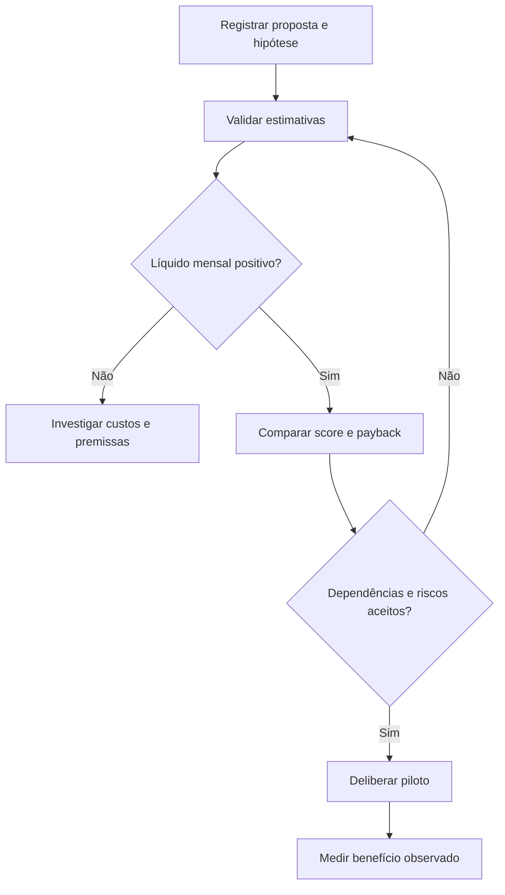

# Business case de melhorias no atendimento — contexto Bradesco

Estudo independente preparado com assistência de IA, ligado ao contexto da experiência profissional no Bradesco informada pelo autor. Dados, atores, políticas, valores e processos são fictícios. Não representa projeto realizado no banco, procedimento interno, aprovação institucional ou resultado empresarial. Não usa dados de clientes. A experiência informada contextualiza a escolha do problema; o estudo demonstra artefatos de análise.

## Problema e objetivo

Como comparar propostas para reduzir retrabalho no atendimento quando capacidade e orçamento são limitados?

**Competências:** descoberta, processos, requisitos funcionais, regras, critérios de aceite, riscos e apoio à decisão.

## Processo atual e proposto

AS-IS hipotético: propostas disputam prioridade por percepção de urgência, sem explicitar custo recorrente ou incerteza do benefício.

**TO-BE:** Analista registra hipótese → gestor revisa estimativas → calcula cenários → compara score e payback → comitê delibera escopo → piloto mede benefício. Protótipo cobre apenas cálculo por proposta.

### Fluxo proposto



O fluxo representa a proposta didática; não é um processo interno confirmado do Bradesco.

## Escopo e responsáveis hipotéticos

Analista de Negócios documenta e mantém rastreabilidade; atendente fornece exemplos; gestor de operação revisa política; tecnologia avalia viabilidade; responsável de negócio decide aceite. Não houve entrevista ou validação com essas pessoas.

MVP: classificar ou calcular uma entrada de cada vez. Fora do escopo: integração bancária, persistência, permissões reais, trilha de auditoria e implantação. A saída é apoio à análise humana.

## Histórias e requisitos

Como responsável pela operação, quero aplicar critérios explícitos para entender o encaminhamento e conferir exceções. Como analista, quero comparar entradas e saídas para discutir regras com negócio e tecnologia.

| ID | Regra Must / critério de aceite | Cenários |
|---|---|---|
| P1 | Calcular líquido mensal = benefício × confiança − custo mensal | C01, C02 |
| P2 | Não calcular payback quando líquido for zero ou negativo | C03, C04 |
| P3 | Calcular payback simples = investimento inicial / líquido positivo | C05 |
| P4 | Calcular score = líquido mensal / esforço; desempate fica para decisão humana | C06 |
| P5 | Rejeitar não finitos, custos negativos, confiança fora de 0 a 1 e esforço não positivo | C07, C08, C09, C10, C11, C12 |

## Contrato de dados

Valores monetários mensais em reais; confiança entre 0 e 1 é peso subjetivo, não probabilidade calibrada; esforço em pessoa-dia positivo. Saídas decimais com duas casas, arredondamento half-up. Não há desconto financeiro, imposto, inflação ou recomendação de investimento.

## Critérios de aceite executáveis

[Cenários e entradas fictícias](cenarios.json) · [Protótipo](prototipo.py) · [Resultado da execução](resultado.md).

Cada cenário explicita Dado (entrada), Quando (avaliar), Então (esperado), com ID e requisito. Os resultados esperados foram definidos como exemplos de negócio, incluindo fronteiras e rejeições.

Na raiz do repositório, execute com Python 3.10+ sem dependências:

```bash
python analise-negocios/novos-casos/validar.py
```

## Indicadores e limites de interpretação

Payback simples em meses e score em R$/mês por pessoa-dia. Benefício é hipótese, não receita realizada. Medir no piloto tempo por atendimento, volume e retrabalho com a mesma definição antes/depois; não atribuir causalidade sem desenho adequado.

## Descoberta, alternativas e decisões

Comparar checklist de cadastro, padronização de motivos e painel de pendências. Dependências, obrigações e experiência do cliente podem prevalecer sobre score. Como validar horas poupadas? Há dupla contagem? A economia libera capacidade ou reduz custo desembolsado?

Alternativas: manter conferência manual com checklist; adotar triagem por regras; integrar ao fluxo operacional. Escolha de estudo: regra local reproduzível, por permitir conferir fronteiras sem depender de sistemas. A escolha não comprova viabilidade de integração.

## Riscos, mudança e homologação

Riscos: hipótese incorreta de processo, regra ambígua, dados incompletos e automação indevida de uma decisão humana. Mitigação proposta: revisão com negócio, exemplos de exceção e piloto autorizado.

Mudança de regra exige atualizar requisito, cenário, protótipo e resultado, e avaliar efeitos em solicitações em andamento. Testes locais não equivalem a homologação empresarial.

Plano de aceite pendente: revisar o fluxo com responsável de negócio; validar os exemplos; registrar divergências; ajustar regras; executar amostra sintética acompanhada; obter decisão explícita do responsável. Não há aceite ou implantação concluídos.

## Como apresentar em entrevista

Explique o problema, uma hipótese ainda não validada, uma regra de fronteira e a diferença entre resultado do protótipo e benefício real. Execute um cenário alterando a entrada e justifique a saída. Apresente este material como estudo de portfólio ligado ao seu repertório bancário.

[Contexto, fontes e roteiro geral](../README.md)
