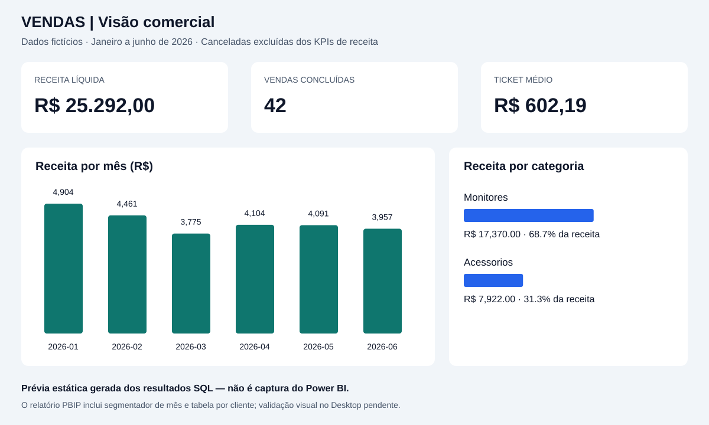

# Dashboard de vendas — Power BI

Projeto editável **PBIP**: modelo semântico em TMSL (`model.bim`), consultas Power Query M, cinco medidas DAX e uma página de relatório PBIR com sete visuais. Dados fictícios embutidos no modelo, iguais aos [CSVs publicados](../dados/). Não é apenas um roteiro de dashboard.

## Abrir no Windows

1. Baixe ou clone o repositório inteiro, preservando as pastas.
2. Use uma versão atual do Power BI Desktop com suporte a projetos PBIP e PBIR. Se solicitado, habilite os recursos correspondentes em Opções > Recursos de visualização e reinicie.
3. Abra `Vendas.pbip` (ou `Vendas.Report/definition.pbir`).
4. Clique em Atualizar para carregar as tabelas M embutidas. Não há credenciais, serviço pago ou caminho local para configurar.
5. Confira os cartões sem filtros: receita **R$ 25292.00**, vendas concluídas **42**, ticket **R$ 602.19**.
6. Selecione meses no segmentador e compare os valores com `../sql-vendas/resultados/02_receita_mensal.csv`. Limpe o filtro para voltar ao total.

## Página e modelo

Três cartões, receita por mês, receita por categoria, tabela por cliente e segmentador de mês. Modelo estrela: Clientes, Produtos e Calendario filtram Vendas por relações 1:N unidirecionais. O grão é uma venda de um produto. Meses usam texto ISO `AAAA-MM`, cuja ordenação alfabética é cronológica.

O calendário é diário, de janeiro a junho de 2026; a chave data é texto ISO para manter a importação didática. Não há medidas de inteligência temporal nesta versão. Uma evolução será migrar a chave para tipo Date e marcar a tabela como calendário.

## Medidas e regras

Veja [medidas.dax](medidas.dax). Receita, vendas concluídas, ticket e unidades excluem canceladas. KEEPFILTERS mantém a interseção com filtros existentes. A taxa de cancelamento usa todas as vendas no contexto como denominador; com um filtro de status, o denominador também muda. Ticket usa número de vendas, não unidades. Não há cálculo de lucro.

## Conferência e limites

Os dados, contagens e somas foram conferidos com SQLite; os resultados esperados estão publicados. A estrutura JSON e as referências de campos são verificadas pelo script de validação. **O Power BI Desktop não está disponível no ambiente de criação: abertura, atualização, execução DAX e renderização dos visuais ainda precisam de validação nele.** Os valores esperados foram calculados em SQL, sem alegação de execução DAX.

O modelo usa dados embutidos para ser portátil; alterar os CSVs não o atualiza automaticamente. As cópias M ficam em `power-query/` para leitura. Dados e indicadores são didáticos, sem impacto empresarial comprovado.

## Documentação Microsoft

- https://learn.microsoft.com/en-us/power-bi/developer/projects/projects-overview
- https://learn.microsoft.com/en-us/power-bi/developer/projects/projects-report
- https://learn.microsoft.com/en-us/power-bi/developer/projects/projects-dataset
